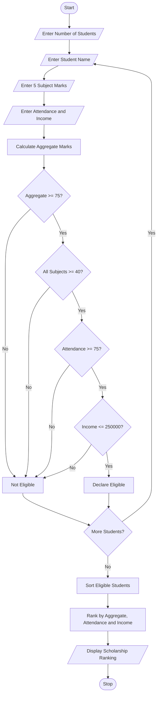

# 1. University Scholarship Allocation System

## 1. Problem Statement

The University Scholarship Allocation System is designed to evaluate students based on their academic performance, attendance, and family income.

The system checks the following criteria:

1. Aggregate Marks: Student must score at least 75%.
2. Subject-wise Minimum Marks: Student must score at least 40 marks in every subject.
3. Attendance: Student must have at least 75% attendance.
4. Family Income: Annual family income must not exceed ₹2,50,000.

The system selects eligible students, ranks them based on aggregate marks, and resolves ties using attendance and family income. Students with higher attendance get priority, followed by students with lower family income.

## 2. Algorithm

1. Start the program.
2. Read the number of students.
3. Enter each student's name.
4. Enter marks in five subjects.
5. Calculate total marks and aggregate percentage.
6. Enter attendance percentage.
7. Enter annual family income.
8. Check all eligibility criteria:
   - Aggregate marks ≥ 75%.
   - Every subject mark ≥ 40.
   - Attendance ≥ 75%.
   - Family income ≤ ₹2,50,000.
9. If all conditions are satisfied, declare the student eligible.
10. Store all eligible students.
11. Sort eligible students based on:
    - Highest aggregate percentage.
    - Highest attendance.
    - Lowest family income.
12. Display the scholarship ranking.
13. Stop the program.

## 3. Flowchart

## 4. Python Source Code

```
    total = sum(marks)    aggregate = total / 5    if (aggregate >= 75 and        min(marks) >= 40 and        attendance >= 75 and        income <= 250000):        print(name, "is Eligible")                students.append({            "name": name,            "aggregate": aggregate,            "attendance": attendance,            "income": income        })    else:        print(name, "is Not Eligible")# Ranking eligible studentsstudents.sort(    key=lambda x: (        -x["aggregate"],        -x["attendance"],        x["income"]    ))print("\n===== SCHOLARSHIP RANKING =====")if len(students) == 0:    print("No eligible students found.")else:    for rank, student in enumerate(students, start=1):        print("\nRank:", rank)        print("Name:", student["name"])        print("Aggregate:", student["aggregate"], "%")        print("Attendance:", student["attendance"], "%")        print("Family Income: Rs.", student["income"])print("\nProgram Completed")
```

## 5. Sample Input

```
Enter number of students: 3

Enter details of Student 1
Enter student name: Karthik
Enter marks in subject 1: 85
Enter marks in subject 2: 90
Enter marks in subject 3: 80
Enter marks in subject 4: 88
Enter marks in subject 5: 87
Enter attendance percentage: 90
Enter annual family income: 200000

Enter details of Student 2
Enter student name: Rahul
Enter marks in subject 1: 80
Enter marks in subject 2: 85
Enter marks in subject 3: 82
Enter marks in subject 4: 80
Enter marks in subject 5: 83
Enter attendance percentage: 85
Enter annual family income: 180000

Enter details of Student 3
Enter student name: Arjun
Enter marks in subject 1: 60
Enter marks in subject 2: 70
Enter marks in subject 3: 65
Enter marks in subject 4: 75
Enter marks in subject 5: 80
Enter attendance percentage: 80
Enter annual family income: 150000
```

## 6. Sample Output

```
Karthik is Eligible
Rahul is Eligible
Arjun is Not Eligible

===== SCHOLARSHIP RANKING =====

Rank: 1
Name: Karthik
Aggregate: 86.0 %
Attendance: 90.0 %
Family Income: Rs. 200000.0

Rank: 2
Name: Rahul
Aggregate: 82.0 %
Attendance: 85.0 %
Family Income: Rs. 180000.0

Program Completed
```

## 7. Mermaid Flowchart Code


## 8. Conclusion

The University Scholarship Allocation System successfully checks student eligibility using academic marks, attendance, and family income. It ranks eligible students based on aggregate marks, attendance, and family income. This system makes scholarship selection easier, faster, and more transparent.

Note: The eligibility limits and tie-breaking rules used here are assumed rules for this academic project. They can be changed according to university guidelines.
