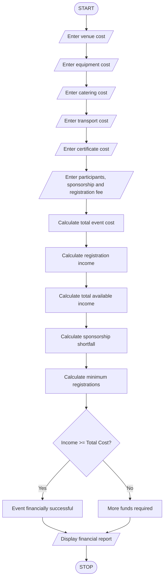

# Campus Event Financial Planning – Python Program

## 1. Problem Statement

Develop a Python program to calculate the total expenses required for conducting a campus event. The program should calculate venue, equipment, catering, transport, and certificate costs.

It should also:

- Calculate the total event cost.
- Calculate the contribution amount per participant.
- Calculate the sponsorship amount received.
- Identify the sponsorship shortfall.
- Calculate the minimum number of registrations required to break even.
- Display whether the event is financially successful or not.

## 2. Algorithm

1. Start the program.
2. Read venue cost.
3. Read equipment cost.
4. Read catering cost.
5. Read transport cost.
6. Read certificate cost.
7. Read expected participants.
8. Read sponsorship amount.
9. Read registration fee per participant.
10. Calculate total event cost.
11. Calculate total registration income.
12. Calculate total available income.
13. Calculate sponsorship shortfall, if any.
14. Calculate the minimum registration count required to break even.
15. Display all financial details.
16. Stop the program.

## 3. Flowchat


## 4. Python Source Code

```
import mathprint("CAMPUS EVENT FINANCIAL PLANNING")# Input costsvenue = float(input("Enter venue cost: "))equipment = float(input("Enter equipment cost: "))catering = float(input("Enter catering cost: "))transport = float(input("Enter transport cost: "))certificate = float(input("Enter certificate cost: "))# Input detailsparticipants = int(input("Enter expected participants: "))sponsorship = float(input("Enter sponsorship amount: "))fee = float(input("Enter registration fee per participant: "))# Calculate total expensestotal_cost = venue + equipment + catering + transport + certificate# Calculate registration incomeregistration_income = participants * fee# Total available incometotal_income = registration_income + sponsorship# Sponsorship shortfallshortfall = max(0, total_cost - sponsorship)# Minimum registrations for break-evenif fee > 0:    minimum = math.ceil(shortfall / fee)else:    minimum = 0 if sponsorship >= total_cost else -1# Display resultsprint("\n----- EVENT FINANCIAL REPORT -----")print("Total Event Cost:", total_cost)print("Registration Income:", registration_income)print("Sponsorship Amount:", sponsorship)print("Total Available Income:", total_income)print("Sponsorship Shortfall:", max(0, total_cost - sponsorship))if minimum == -1:    print("Break-even is not possible with zero registration fee")else:
```

## 5. Sample Input

```
CAMPUS EVENT FINANCIAL PLANNING

Enter venue cost: 10000
Enter equipment cost: 5000
Enter catering cost: 20000
Enter transport cost: 5000
Enter certificate cost: 2000
Enter expected participants: 100
Enter sponsorship amount: 15000
Enter registration fee per participant: 300
```

## 6. Sample Output

```
----- EVENT FINANCIAL REPORT -----

Total Event Cost: 42000.0
Registration Income: 30000.0
Sponsorship Amount: 15000.0
Total Available Income: 45000.0
Sponsorship Shortfall: 27000.0
Minimum Registrations Required: 90
Result: Event is financially successful
Remaining Amount: 0
```

Calculation:

- Total cost = 10,000 + 5,000 + 20,000 + 5,000 + 2,000 = ₹42,000
- Registration income = 100 × ₹300 = ₹30,000
- Total income = ₹30,000 + ₹15,000 = ₹45,000
- Sponsorship shortfall = ₹42,000 − ₹15,000 = ₹27,000
- Minimum registrations = ₹27,000 ÷ ₹300 = 90

Revenue

Total cost

Loss

Profit

10203040506050010001500Quantity$Q\*

\\(Q^\*=\frac{F}{p-v}=\frac{\text{600}}{\text{35}-\text{15}}=\text{30}\\)

Q\* is the break-even quantity where total revenue matches total cost.

\\(F\\)

$

\\(v\\)

$/unit

\\(p\\)

$/unit

Give feedback

## 7. Mermaid Flowchart Code


Result: The Python program calculates the campus event expenses, registration contributions, sponsorship shortfall, and minimum registrations needed to break even.
