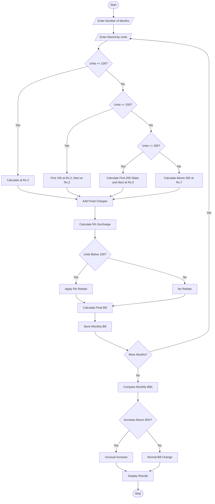

# 3. Progressive Electricity Billing System

Python Programming Project

## 1. Problem Statement

The Progressive Electricity Billing System is designed to calculate household electricity bills based on monthly electricity consumption.

The system uses multiple consumption slabs, fixed charges, surcharges, and rebates to calculate the final electricity bill.

The system performs the following operations:

1. Accept monthly electricity consumption in units.
2. Calculate charges using different electricity slabs.
3. Add fixed charges to the bill.
4. Calculate additional surcharges.
5. Apply rebates when applicable.
6. Calculate the final monthly bill.
7. Compare electricity bills across several months.
8. Identify unusual increases in electricity bills.

Electricity tariff rules used in this project (example):

| Consumption slab | Rate per unit |
| ---------------- | ------------- |
| First 100 units  | ₹2            |
| Next 100 units   | ₹3            |
| Next 100 units   | ₹5            |
| Above 300 units  | ₹7            |

Additional rules:

- Fixed charge: ₹50 per month.
- Surcharge: 5% of energy charges.
- Rebate: 5% of energy charges if consumption is below 100 units.
- Unusual increase: Bill increases by more than 30% compared with the previous month.

## 2. Algorithm

1. Start the program.
2. Enter the number of months.
3. Enter electricity consumption for each month.
4. Calculate the first 100 units at ₹2 per unit.
5. Calculate the next 100 units at ₹3 per unit.
6. Calculate the next 100 units at ₹5 per unit.
7. Calculate remaining units at ₹7 per unit.
8. Add fixed charges of ₹50.
9. Calculate a 5% surcharge on energy charges.
10. Apply a 5% rebate if consumption is below 100 units.
11. Calculate the final bill.
12. Store the monthly bill details.
13. Compare each month's bill with the previous month.
14. Identify increases greater than 30%.
15. Display monthly bills and unusual increases.
16. Stop the program.

## 3. Flowchart

    
## 4. Python Source Code

The following is a simple Python program suitable for your assignment.

```
        energy = (100 * 2) + (100 * 3) + (units - 200) * 5    else:        energy = (100 * 2) + (100 * 3) + (100 * 5) + (units - 300) * 7    # Fixed charge    fixed = 50    # Surcharge    surcharge = energy * 0.05    # Rebate    if units < 100:        rebate = energy * 0.05    else:        rebate = 0    # Final bill    total = energy + fixed + surcharge - rebate    bills.append(total)    print("Energy Charges: Rs.", round(energy, 2))    print("Fixed Charges: Rs.", fixed)    print("Surcharge: Rs.", round(surcharge, 2))    print("Rebate: Rs.", round(rebate, 2))    print("Final Bill: Rs.", round(total, 2))# Compare monthly billsprint("\n===== MONTHLY BILL COMPARISON =====")for i in range(n):    print("Month", i + 1, "Bill: Rs.", round(bills[i], 2))    if i > 0:        increase = bills[i] - bills[i - 1]        if bills[i - 1] > 0:            percentage = (increase / bills[i - 1]) * 100        else:            percentage = 0        if percentage > 30:            print("Unusual Increase Detected!")        else:            print("Normal Bill Change")        print("Bill Change:", round(increase, 2))        print("Percentage Change:", round(percentage, 2), "%")print("\nTotal Electricity Bill: Rs.", round(sum(bills), 2))print("Program Completed")
```

## 5. Sample Input

```
Enter number of months: 3

Month 1
Enter electricity units consumed: 80

Month 2
Enter electricity units consumed: 150

Month 3
Enter electricity units consumed: 250
```

## 6. Sample Output

```
Month 1
Energy Charges: Rs. 160.0
Fixed Charges: Rs. 50
Surcharge: Rs. 8.0
Rebate: Rs. 8.0
Final Bill: Rs. 210.0

Month 2
Energy Charges: Rs. 350.0
Fixed Charges: Rs. 50
Surcharge: Rs. 17.5
Rebate: Rs. 0
Final Bill: Rs. 417.5

Month 3
Energy Charges: Rs. 750.0
Fixed Charges: Rs. 50
Surcharge: Rs. 37.5
Rebate: Rs. 0
Final Bill: Rs. 837.5

===== MONTHLY BILL COMPARISON =====

Month 1 Bill: Rs. 210.0

Month 2 Bill: Rs. 417.5
Unusual Increase Detected!
Bill Change: 207.5
Percentage Change: 98.81 %

Month 3 Bill: Rs. 837.5
Unusual Increase Detected!
Bill Change: 420.0
Percentage Change: 100.6 %

Total Electricity Bill: Rs. 1465.0
Program Completed
```

## 7. Mermaid Flowchart Code


## 8. Conclusion

The Progressive Electricity Billing System calculates household electricity bills using multiple consumption slabs, fixed charges, surcharges, and rebates. It compares monthly bills and identifies unusual increases in electricity consumption costs.

Result: Thus, the Progressive Electricity Billing System was successfully implemented using Python programming.

Assignment tip: Write the problem statement, algorithm, flowchart, Python source code, sample input, sample output, Mermaid flowchart code, and conclusion in the same order in your practical record.
