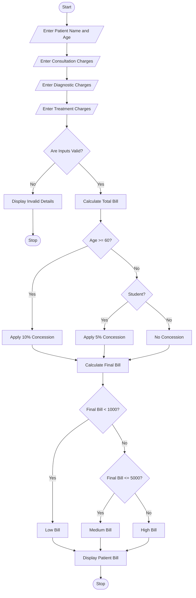

# 4. Hospital Billing and Patient Classification System

Python Programming Project

## 1. Problem Statement

The Hospital Billing and Patient Classification System is designed to calculate patient hospital bills based on consultation charges, diagnostic charges, and treatment charges.

The system applies conditional concessions, validates billing details, and classifies patients according to their payment amount.

The system performs the following operations:

1. Accept patient details.
2. Enter consultation charges.
3. Enter diagnostic charges.
4. Enter treatment charges.
5. Calculate the total hospital bill.
6. Apply concessions based on patient category.
7. Validate billing constraints.
8. Calculate the final payable amount.
9. Classify patients according to the payment policy.
10. Display the final bill.

Billing rules used in this project (example):

| Patient category                   | Concession    |
| ---------------------------------- | ------------- |
| Senior citizen (60 years or above) | 10%           |
| Student (valid student ID)         | 5%            |
| General patient                    | No concession |

Patient classification policy:

| Final bill amount | Classification |
| ----------------- | -------------- |
| Below ₹1,000      | Low Bill       |
| ₹1,000–₹5,000     | Medium Bill    |
| Above ₹5,000      | High Bill      |

Additional conditions:

- Charges must not be negative.
- Patient age must be greater than zero.
- Only one concession is applied.
- Senior citizen concession gets priority over student concession.

## 2. Algorithm

1. Start the program.
2. Enter the patient name.
3. Enter the patient's age.
4. Enter patient category.
5. Enter consultation charges.
6. Enter diagnostic charges.
7. Enter treatment charges.
8. Validate age and charges.
9. Calculate total charges.
10. Check whether the patient is a senior citizen.
11. If age is 60 or above, apply a 10% concession.
12. Otherwise, if the patient is a student, apply a 5% concession.
13. Otherwise, apply no concession.
14. Calculate the final payable amount.
15. Classify the patient bill:
    - Below ₹1,000: Low Bill.
    - ₹1,000 to ₹5,000: Medium Bill.
    - Above ₹5,000: High Bill.
16. Display the complete bill.
17. Stop the program.

## 3. Flowchart


## 4. Python Source Code

The following is a simple Python program suitable for your college assignment.

```
        concession = total * 0.10        category = "Senior Citizen"    elif student == "yes":        concession = total * 0.05        category = "Student"    else:        concession = 0        category = "General Patient"    # Calculate final bill    final_bill = total - concession    # Patient classification    if final_bill < 1000:        classification = "Low Bill"    elif final_bill <= 5000:        classification = "Medium Bill"    else:        classification = "High Bill"    # Display bill    print("\n===== PATIENT BILL DETAILS =====")    print("Patient Name:", name)    print("Patient Age:", age)    print("Patient Category:", category)    print("Consultation Charges: Rs.", consultation)    print("Diagnostic Charges: Rs.", diagnostic)    print("Treatment Charges: Rs.", treatment)    print("Total Bill: Rs.", total)    print("Concession: Rs.", concession)    print("Final Payable Amount: Rs.", final_bill)    print("Patient Classification:", classification)    print("\nBilling Completed Successfully!")
```

## 5. Sample Input

```
===== HOSPITAL BILLING SYSTEM =====

Enter patient name: Ravi
Enter patient age: 65

Enter consultation charges: Rs. 500
Enter diagnostic charges: Rs. 1500
Enter treatment charges: Rs. 4000

Is patient a student? (yes/no): no
```

## 6. Sample Output

```
===== PATIENT BILL DETAILS =====

Patient Name: Ravi
Patient Age: 65
Patient Category: Senior Citizen

Consultation Charges: Rs. 500.0
Diagnostic Charges: Rs. 1500.0
Treatment Charges: Rs. 4000.0

Total Bill: Rs. 6000.0
Concession: Rs. 600.0

Final Payable Amount: Rs. 5400.0

Patient Classification: High Bill

Billing Completed Successfully!
```

## 7. Mermaid Flowchart Code


## 8. Conclusion

The Hospital Billing and Patient Classification System calculates hospital bills using consultation, diagnostic, and treatment charges. It applies concessions based on patient eligibility, validates billing details, and classifies patients according to their final payment amount.

Result: Thus, the Hospital Billing and Patient Classification System was successfully implemented using Python programming.

Note: All billing rates, concessions, and classification limits are assumed for this academic project and are not actual hospital tariff rules.
