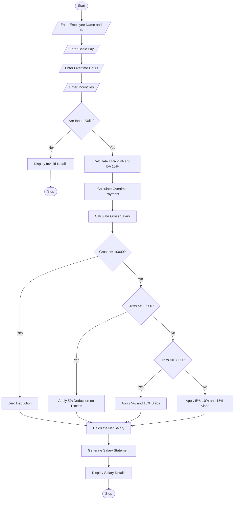

# 5. Employee Payroll and Deduction Analysis System

Python Programming Project

## 1. Problem Statement

The Employee Payroll and Deduction Analysis System is designed to calculate employee salaries based on basic pay, allowances, overtime, and incentives.

The system calculates gross salary, applies progressive deductions, and generates a formatted salary statement showing the final net salary.

The system performs the following operations:

1. Accept employee details.
2. Enter basic salary.
3. Calculate allowances.
4. Enter overtime payment.
5. Enter incentives.
6. Calculate gross salary.
7. Apply progressive deductions.
8. Calculate net salary.
9. Generate a formatted salary statement.

Salary rules used in this project (example):

| Salary component           | Amount           |
| -------------------------- | ---------------- |
| Basic Pay                  | ₹20,000          |
| House Rent Allowance (HRA) | 20% of basic pay |
| Dearness Allowance (DA)    | 10% of basic pay |
| Overtime                   | Hours × ₹150     |
| Incentives                 | User entered     |

Progressive deduction rules:

| Gross salary slab | Deduction rate |
| ----------------- | -------------- |
| First ₹10,000     | 0%             |
| Next ₹10,000      | 5%             |
| Next ₹10,000      | 10%            |
| Above ₹30,000     | 15%            |

These are example rates for the academic project, not actual statutory tax rates.

## 2. Algorithm

1. Start the program.
2. Enter employee name and ID.
3. Enter basic salary.
4. Enter overtime hours.
5. Enter incentive amount.
6. Calculate HRA as 20% of basic salary.
7. Calculate DA as 10% of basic salary.
8. Calculate overtime payment at ₹150 per hour.
9. Calculate gross salary by adding all salary components.
10. Apply progressive deductions:
    - First ₹10,000: 0%.
    - Next ₹10,000: 5%.
    - Next ₹10,000: 10%.
    - Above ₹30,000: 15%.
11. Calculate net salary.
12. Display the formatted salary statement.
13. Stop the program.

## 3. Flowchart


## 4. Python Source Code

The following simple Python program calculates gross salary, progressive deductions, and net salary.

```
# Employee Payroll and Deduction Analysisprint("===== EMPLOYEE PAYROLL SYSTEM =====")name = input("Enter employee name: ")emp_id = input("Enter employee ID: ")basic = float(input("Enter basic pay: Rs. "))hours = float(input("Enter overtime hours: "))incentive = float(input("Enter incentive amount: Rs. "))# Validate inputif basic < 0 or hours < 0 or incentive < 0:    print("Invalid Salary Details!")else:    # Calculate allowances    hra = basic * 0.20    da = basic * 0.10    # Calculate overtime payment    overtime = hours * 150    # Calculate gross salary    gross = basic + hra + da + overtime + incentive    # Progressive deductions    if gross <= 10000:        deduction = 0    elif gross <= 20000:        deduction = (gross - 10000) * 0.05    elif gross <= 30000:        deduction = (10000 * 0.05) + (gross - 20000) * 0.10    else:        deduction = (10000 * 0.05) + (10000 * 0.10) + (gross - 30000) * 0.15    # Calculate net salary    net = gross - deduction    # Display salary statement    print("\n===== SALARY STATEMENT =====")    print("Employee Name:", name)    print("Employee ID:", emp_id)    print("----------------------------")    print("Basic Pay: Rs.", basic)    print("HRA: Rs.", hra)    print("DA: Rs.", da)    print("Overtime: Rs.", overtime)    print("Incentives: Rs.", incentive)    print("----------------------------")    print("Gross Salary: Rs.", gross)    print("Total Deduction: Rs.", round(deduction, 2))    print("Net Salary: Rs.", round(net, 2))
```

## 5. Sample Input

```
===== EMPLOYEE PAYROLL SYSTEM =====

Enter employee name: Karthik
Enter employee ID: 101

Enter basic pay: Rs. 20000
Enter overtime hours: 10
Enter incentive amount: Rs. 2000
```

## 6. Sample Output

```
===== SALARY STATEMENT =====

Employee Name: Karthik
Employee ID: 101

----------------------------
Basic Pay: Rs. 20000.0
HRA: Rs. 4000.0
DA: Rs. 2000.0
Overtime: Rs. 1500.0
Incentives: Rs. 2000.0

----------------------------
Gross Salary: Rs. 29500.0
Total Deduction: Rs. 1450.0
Net Salary: Rs. 28050.0

----------------------------
Payroll Completed Successfully!
```

## 7. Mermaid Flowchart Code


## 8. Conclusion

The Employee Payroll and Deduction Analysis System calculates employee gross salary using basic pay, allowances, overtime, and incentives. It applies progressive deductions and generates a formatted salary statement showing the employee's final net salary.

Result: Successfully Implemented

Result: Thus, the Employee Payroll and Deduction Analysis System was successfully implemented using Python programming.

Note: All allowance percentages and deduction slabs are assumed values for this academic project.
