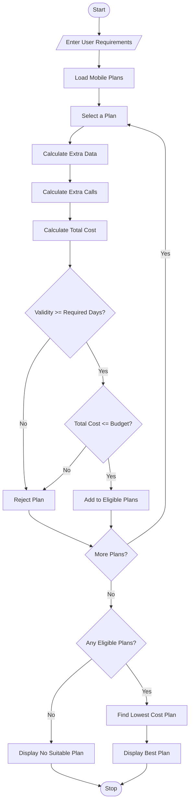

# 6. Multi-Plan Telecommunications Cost Optimization System

Python Programming Project

## 1. Problem Statement

The Multi-Plan Telecommunications Cost Optimization System is designed to compare different mobile recharge plans based on user requirements such as data usage, call minutes, validity, and budget.

The system evaluates multiple mobile plans, calculates excess usage charges, checks budget constraints, and identifies the most economical eligible plan.

The system performs the following operations:

1. Accept the user's data usage.
2. Accept required call minutes.
3. Enter required validity days.
4. Enter the user's budget.
5. Compare different mobile plans.
6. Calculate excess data and call charges.
7. Calculate the total plan cost.
8. Check validity and budget constraints.
9. Identify the most economical eligible plan.
10. Display the best mobile plan.

Mobile plan details used in this project (example):

| Plan   | Price | Data  | Calls    | Validity |
| ------ | ----- | ----- | -------- | -------- |
| Plan A | ₹199  | 2 GB  | 200 min  | 28 days  |
| Plan B | ₹299  | 5 GB  | 500 min  | 56 days  |
| Plan C | ₹399  | 10 GB | 1000 min | 84 days  |
| Plan D | ₹499  | 15 GB | 1500 min | 90 days  |

Additional charges:

- Extra data charge: ₹20 per GB.
- Extra call charge: ₹1 per minute.
- Select only plans within the user's budget.
- Plan validity must meet the required validity.
- Select the plan with the lowest total cost.

## 2. Algorithm

1. Start the program.
2. Enter required data usage.
3. Enter required call minutes.
4. Enter required validity days.
5. Enter the user's budget.
6. Store the available mobile plans.
7. Read each mobile plan.
8. Calculate excess data usage.
9. Calculate excess call charges.
10. Calculate the total plan cost.
11. Check whether the plan meets validity requirements.
12. Check whether the plan is within budget.
13. Store eligible plans.
14. Compare the total costs of eligible plans.
15. Select the lowest-cost plan.
16. Display the best plan and its details.
17. If no plan is eligible, display a suitable message.
18. Stop the program.

## 3. Flowchart


## 4. Python Source Code

```
# Multi-Plan Telecommunications Cost Optimizationprint("===== MOBILE PLAN OPTIMIZATION SYSTEM =====")# User requirementsdata = float(input("Enter required data usage (GB): "))calls = int(input("Enter required call minutes: "))validity = int(input("Enter required validity days: "))budget = float(input("Enter your budget (Rs.): "))# Available mobile plansplans = [    {"name": "Plan A", "price": 199,     "data": 2, "calls": 200, "days": 28},    {"name": "Plan B", "price": 299,     "data": 5, "calls": 500, "days": 56},    {"name": "Plan C", "price": 399,     "data": 10, "calls": 1000, "days": 84},    {"name": "Plan D", "price": 499,     "data": 15, "calls": 1500, "days": 90}]eligible = []# Validate user inputif data < 0 or calls < 0 or validity <= 0 or budget < 0:    print("Invalid Input!")else:    print("\n===== PLAN COMPARISON =====")
```

## 5. Sample Input

```
===== MOBILE PLAN OPTIMIZATION SYSTEM =====

Enter required data usage (GB): 8
Enter required call minutes: 800
Enter required validity days: 28
Enter your budget (Rs.): 500
```

## 6. Sample Output

```
===== PLAN COMPARISON =====

Plan A
Plan Price: Rs. 199
Extra Data Charge: Rs. 120
Extra Call Charge: Rs. 600
Total Cost: Rs. 919

Plan B
Plan Price: Rs. 299
Extra Data Charge: Rs. 60
Extra Call Charge: Rs. 300
Total Cost: Rs. 659

Plan C
Plan Price: Rs. 399
Extra Data Charge: Rs. 0
Extra Call Charge: Rs. 0
Total Cost: Rs. 399

Plan D
Plan Price: Rs. 499
Extra Data Charge: Rs. 0
Extra Call Charge: Rs. 0
Total Cost: Rs. 499

===== BEST MOBILE PLAN =====

Best Plan: Plan C
Total Cost: Rs. 399
Validity: 84 days
Status: Eligible

Program Completed Successfully!
```

## 7. Mermaid Flowchart Code


## 8. Conclusion

The Multi-Plan Telecommunications Cost Optimization System compares different mobile plans based on data usage, call minutes, validity, and budget. It calculates excess charges and identifies the most economical eligible mobile plan.

Result: Successfully Implemented

Result: Thus, the Multi-Plan Telecommunications Cost Optimization System was successfully implemented using Python programming.

Note: The mobile plans and extra usage rates are assumed values for this academic project, not actual telecom operator tariffs.
