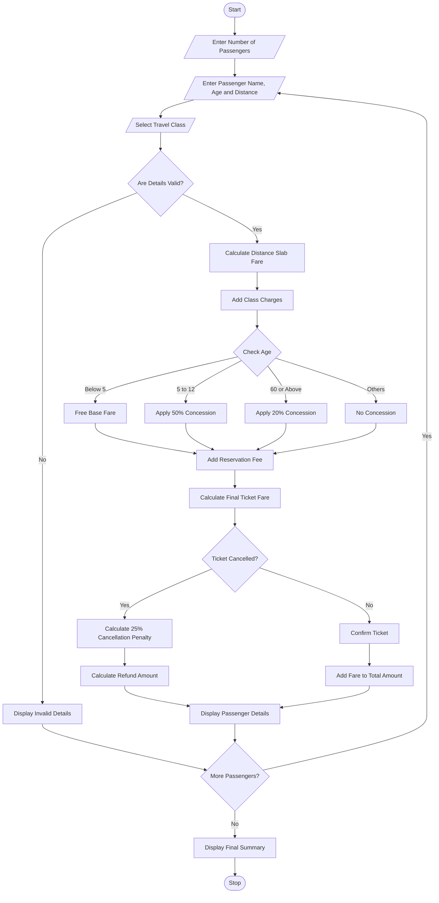

# 7. Railway Fare and Reservation Calculator

Python Programming Project

## 1. Problem Statement

The Railway Fare and Reservation Calculator is designed to calculate railway ticket fares for multiple passengers based on travel distance, travel class, age-based concessions, reservation fees, and cancellation penalties.

The system performs the following operations:

1. Accept the number of passengers.
2. Enter passenger names and ages.
3. Enter the travel distance.
4. Select the travel class.
5. Calculate fare based on distance slabs.
6. Apply age-based concessions.
7. Add reservation fees.
8. Calculate the total ticket amount.
9. Calculate cancellation penalties when a ticket is cancelled.
10. Display the final fare statement.

Fare rules used in this project (example):

### Distance-based fare

| Distance     | Base fare    |
| ------------ | ------------ |
| First 100 km | ₹2 per km    |
| Next 100 km  | ₹1.50 per km |
| Above 200 km | ₹1 per km    |

### Travel class charges

| Class     | Additional charge |
| --------- | ----------------- |
| Sleeper   | ₹100              |
| AC 3 Tier | ₹300              |
| AC 2 Tier | ₹500              |

### Age-based concessions

- Children below 5 years: Free ticket.
- Children aged 5–12 years: 50% concession on base fare.
- Senior citizens aged 60 or above: 20% concession on base fare.
- Other passengers: No concession.

### Additional charges

- Reservation fee: ₹50 per passenger.
- Cancellation penalty: 25% of the final ticket fare.

These are assumed academic project rules, not actual Indian Railways fare or concession policies.

## 2. Algorithm

1. Start the program.
2. Enter the number of passengers.
3. Enter passenger name and age.
4. Enter journey distance in kilometres.
5. Select the travel class.
6. Calculate base fare using distance slabs.
7. Add travel class charges.
8. Check passenger age.
9. Apply age-based concession on base fare.
10. Add reservation fee.
11. Calculate final ticket fare.
12. Ask whether the ticket is cancelled.
13. If cancelled, calculate a 25% cancellation penalty.
14. Calculate the refundable amount.
15. Repeat the process for all passengers.
16. Display the complete fare statement.
17. Stop the program.

## 3. Flowchart


## 4. Python Source Code

The following is a simple Python program that calculates railway fares for multiple passengers.

```
# Railway Fare and Reservation Calculatorprint("===== RAILWAY FARE CALCULATOR =====")n = int(input("Enter number of passengers: "))total_amount = 0for i in range(n):    print("\nPassenger", i + 1)    name = input("Enter passenger name: ")    age = int(input("Enter passenger age: "))    distance = float(input("Enter travel distance (km): "))    print("1. Sleeper")    print("2. AC 3 Tier")    print("3. AC 2 Tier")    choice = int(input("Select travel class: "))    # Validate input    if age < 0 or distance <= 0 or choice not in [1, 2, 3]:        print("Invalid passenger details!")        continue    # Distance slab fare    if distance <= 100:        base = distance * 2    elif distance <= 200:        base = (100 * 2) + (distance - 100) * 1.5    else:
```

## 5. Sample Input

```
===== RAILWAY FARE CALCULATOR =====

Enter number of passengers: 2

Passenger 1
Enter passenger name: Karthik
Enter passenger age: 25
Enter travel distance (km): 250

1. Sleeper
2. AC 3 Tier
3. AC 2 Tier

Select travel class: 1
Cancel ticket? (yes/no): no

Passenger 2
Enter passenger name: Ravi
Enter passenger age: 65
Enter travel distance (km): 150

1. Sleeper
2. AC 3 Tier
3. AC 2 Tier

Select travel class: 2
Cancel ticket? (yes/no): no
```

## 6. Sample Output

```
===== RAILWAY FARE CALCULATOR =====

Ticket Details

Passenger Name: Karthik
Age: 25
Travel Class: Sleeper
Base Fare: Rs. 350.0
Concession: Rs. 0.0
Class Charge: Rs. 100
Reservation Fee: Rs. 50

Ticket Confirmed!
Final Ticket Fare: Rs. 500.0


Ticket Details

Passenger Name: Ravi
Age: 65
Travel Class: AC 3 Tier
Base Fare: Rs. 275.0
Concession: Rs. 55.0
Class Charge: Rs. 300
Reservation Fee: Rs. 50

Ticket Confirmed!
Final Ticket Fare: Rs. 570.0


===== FINAL SUMMARY =====

Total Confirmed Ticket Amount: Rs. 1070.0

Program Completed Successfully!
```

## 7. Mermaid Flowchart Code


## 8. Conclusion

The Railway Fare and Reservation Calculator calculates ticket fares for multiple passengers using distance-based fare slabs, travel classes, age-based concessions, and reservation fees. It also calculates cancellation penalties and refundable amounts.

Result: Successfully Implemented

Result: Thus, the Railway Fare and Reservation Calculator was successfully implemented using Python programming.

Note: All fare rates, concessions, reservation fees, and cancellation penalties are assumed values for this academic project.
