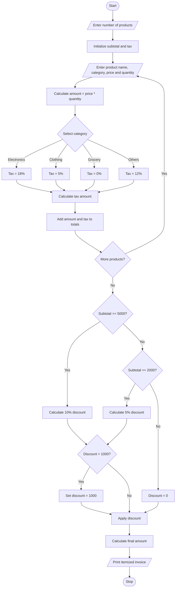

# Retail Billing with Multiple Discount Rules

## 1. Problem Statement

Develop a Python program to generate a retail bill for multiple products. The program should accept product name, category, price, and quantity.

The program must calculate:

- Total price of each product.
- Category-specific tax.
- Threshold-based discounts.
- Maximum concession limit.
- Final payable amount.
- An itemized invoice showing all product details.

Assumed billing rules for this project:

| Category    | Tax rate |
| ----------- | -------- |
| Electronics | 18%      |
| Clothing    | 5%       |
| Grocery     | 0%       |
| Others      | 12%      |

Discount rules:

- Bill amount ₹5,000 or above: 10% discount.
- Bill amount ₹2,000 to ₹4,999: 5% discount.
- Below ₹2,000: No discount.
- Maximum discount allowed: ₹1,000.
- Discount is calculated on the total amount before tax.

## 2. Algorithm

1. Start the program.
2. Read the number of products.
3. For each product, read its name, category, price, and quantity.
4. Calculate the product amount using price × quantity.
5. Calculate tax based on the product category.
6. Add product amount and tax to the subtotal.
7. Calculate the discount based on the subtotal.
8. Apply the maximum discount limit of ₹1,000.
9. Calculate the final bill by subtracting the discount from the subtotal and tax.
10. Display the itemized invoice.
11. Stop the program.

## 3. Flowchart



## 4. Python Source Code

```
print("===== RETAIL BILLING SYSTEM =====")n = int(input("Enter number of products: "))subtotal = 0total_tax = 0print("\n----- PRODUCT DETAILS -----")for i in range(n):    print("\nProduct", i + 1)    name = input("Enter product name: ")    category = input("Enter category: ").lower()    price = float(input("Enter price: "))    quantity = int(input("Enter quantity: "))    if price < 0 or quantity <= 0:        print("Invalid price or quantity!")        continue    amount = price * quantity    # Category-specific tax    if category == "electronics":        tax_rate = 18    elif category == "clothing":        tax_rate = 5    elif category == "grocery":        tax_rate = 0    else:        tax_rate = 12    tax = amount * tax_rate / 100    subtotal += amount    total_tax += tax    print("Product Amount: Rs.", round(amount, 2))    print("Tax:", tax_rate, "%")    print("Tax Amount: Rs.", round(tax, 2))# Discount calculationif subtotal >= 5000:    discount = subtotal * 10 / 100elif subtotal >= 2000:    discount = subtotal * 5 / 100else:    discount = 0# Maximum concession limitif discount > 1000:    discount = 1000# Final billfinal_amount = subtotal + total_tax - discountprint("\n========== FINAL INVOICE ==========")print("Subtotal       : Rs.", round(subtotal, 2))print("Total Tax      : Rs.", round(total_tax, 2))print("Discount       : Rs.", round(discount, 2))print("-----------------------------------")print("Final Amount   : Rs.", round(final_amount, 2))print("===================================")print("Thank you! Visit Again.")
```

## 5. Sample Input

```
Enter number of products: 3

Product 1
Enter product name: Mobile
Enter category: electronics
Enter price: 10000
Enter quantity: 1

Product 2
Enter product name: Shirt
Enter category: clothing
Enter price: 1000
Enter quantity: 2

Product 3
Enter product name: Rice
Enter category: grocery
Enter price: 500
Enter quantity: 2
```

## 6. Sample Output

```
===== RETAIL BILLING SYSTEM =====

----- PRODUCT DETAILS -----

Product 1
Product Amount: Rs. 10000.0
Tax: 18 %
Tax Amount: Rs. 1800.0

Product 2
Product Amount: Rs. 2000.0
Tax: 5 %
Tax Amount: Rs. 100.0

Product 3
Product Amount: Rs. 1000.0
Tax: 0 %
Tax Amount: Rs. 0.0

========== FINAL INVOICE ==========
Subtotal       : Rs. 13000.0
Total Tax      : Rs. 1900.0
Discount       : Rs. 1000.0
-----------------------------------
Final Amount   : Rs. 13900.0
===================================
Thank you! Visit Again.
```

## 7. Mermaid Flowchart Code


Conclusion: This Python program generates an itemized retail invoice by calculating product amounts, category-wise taxes, threshold-based discounts, and maximum concession limits.
