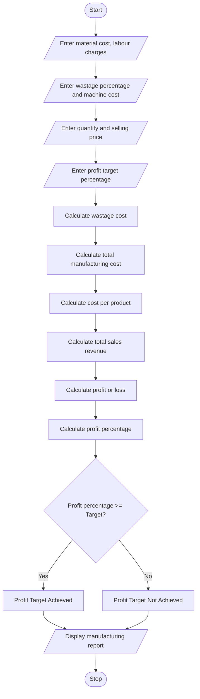

# Manufacturing Cost and Profitability Analysis

## 1. Problem Statement

Develop a Python program to calculate the total manufacturing cost and profit of a product.

The program should accept the following details:

- Material cost
- Labour charges
- Wastage percentage
- Machine cost
- Number of products manufactured
- Selling price per product
- Expected profit target percentage

The program should calculate the total production cost, cost per product, total sales revenue, profit or loss, and profit percentage. Finally, identify whether the production meets the specified profit target.

Assumed calculation rules:

- Wastage cost = Material cost × Wastage percentage / 100.
- Total manufacturing cost = Material cost + Wastage cost + Labour charges + Machine cost.
- Total revenue = Selling price × Quantity.
- Profit = Total revenue − Total manufacturing cost.
- Profit target is achieved if profit percentage is equal to or greater than the target percentage.

## 2. Algorithm

1. Start the program.
2. Read material cost, labour charges, wastage percentage, and machine cost.
3. Read the number of products manufactured.
4. Read selling price per product.
5. Read the expected profit target percentage.
6. Calculate wastage cost.
7. Calculate total manufacturing cost.
8. Calculate cost per product.
9. Calculate total sales revenue.
10. Calculate profit or loss.
11. Calculate profit percentage.
12. Compare the profit percentage with the target percentage.
13. Display all manufacturing cost details and profitability result.
14. Stop the program.

## 3. Flowchart



## 4. Python Source Code

```
print("===== MANUFACTURING COST ANALYSIS =====")# Input detailsmaterial = float(input("Enter material cost: "))labour = float(input("Enter labour charges: "))wastage_percent = float(input("Enter wastage percentage: "))machine = float(input("Enter machine cost: "))quantity = int(input("Enter number of products manufactured: "))selling_price = float(input("Enter selling price per product: "))target = float(input("Enter profit target percentage: "))# Calculate wastage costwastage = material * wastage_percent / 100# Calculate total manufacturing costtotal_cost = material + labour + wastage + machine# Calculate cost per productcost_per_product = total_cost / quantity# Calculate sales revenuerevenue = selling_price * quantity# Calculate profit or lossprofit = revenue - total_cost# Calculate profit percentageprofit_percent = (profit / total_cost) * 100# Display resultsprint("\n===== MANUFACTURING REPORT =====")print("Material Cost       : Rs.", round(material, 2))print("Labour Charges      : Rs.", round(labour, 2))print("Wastage Cost        : Rs.", round(wastage, 2))print("Machine Cost        : Rs.", round(machine, 2))print("Total Production Cost:", round(total_cost, 2))print("Cost Per Product    : Rs.", round(cost_per_product, 2))print("Total Sales Revenue : Rs.", round(revenue, 2))if profit >= 0:    print("Total Profit        : Rs.", round(profit, 2))else:    print("Total Loss          : Rs.", round(abs(profit), 2))print("Profit Percentage   :", round(profit_percent, 2), "%")print("Target Percentage   :", target, "%")# Check profit targetif profit_percent >= target:    print("Result: Profit Target Achieved")else:    print("Result: Profit Target Not Achieved")print("=================================")
```

## 5. Sample Input

```
Enter material cost: 50000
Enter labour charges: 10000
Enter wastage percentage: 5
Enter machine cost: 5000
Enter number of products manufactured: 100
Enter selling price per product: 800
Enter profit target percentage: 20
```

## 6. Sample Output

```
===== MANUFACTURING COST ANALYSIS =====

===== MANUFACTURING REPORT =====
Material Cost       : Rs. 50000.0
Labour Charges      : Rs. 10000.0
Wastage Cost        : Rs. 2500.0
Machine Cost        : Rs. 5000.0
Total Production Cost: 67500.0
Cost Per Product    : Rs. 675.0
Total Sales Revenue : Rs. 80000.0
Total Profit        : Rs. 12500.0
Profit Percentage   : 18.52 %
Target Percentage   : 20.0 %
Result: Profit Target Not Achieved
=================================
```

## 7. Mermaid Flowchart Code


Conclusion: This Python program calculates manufacturing expenses, wastage costs, total production costs, sales revenue, and profit. It also checks whether the manufacturing business achieves its expected profit target.
