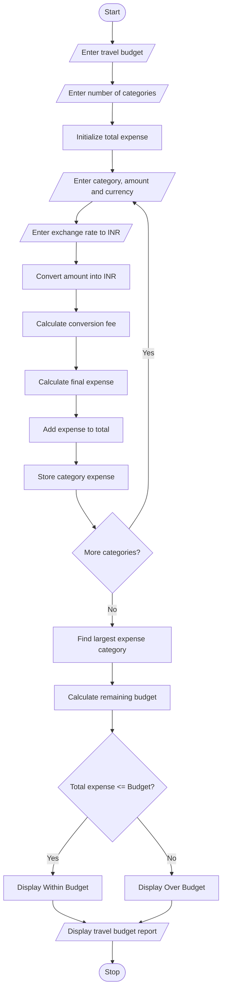

# Multi-Currency Travel Budget Analysis

## 1. Problem Statement

Develop a Python program to analyze travel expenses in different currencies and calculate the total travel expenditure in Indian Rupees (INR).

The program should:

- Accept multiple travel expense categories.
- Read the expense amount and currency.
- Convert foreign currency expenses into INR using supplied exchange rates.
- Calculate conversion fees.
- Compare total spending with the planned travel budget.
- Identify the largest expense category.
- Display the final travel budget report.

Assumed rules for this project:

- Exchange rates are supplied by the user.
- Conversion fee is 2% of the converted amount.
- All expenses are converted into INR.
- The largest expense category is identified using the amount including conversion fees.

## 2. Algorithm

1. Start the program.
2. Enter the planned travel budget in INR.
3. Enter the number of expense categories.
4. For each category:
   - Enter category name.
   - Enter expense amount.
   - Enter currency code.
   - Enter exchange rate against INR.
5. Convert the expense into INR.
6. Calculate the conversion fee.
7. Calculate the total expense including the fee.
8. Add the expense to the total travel expenditure.
9. Store each category's expense.
10. Identify the category with the highest expense.
11. Compare total expenditure with the planned budget.
12. Display the expense details, total expenditure, largest category, and budget status.
13. Stop the program.

## 3. Flowchart


## 4. Python Source Code

```
print("===== MULTI-CURRENCY TRAVEL BUDGET ANALYSIS =====")    rate = float(input("Enter exchange rate to INR: "))    # Convert currency into INR    converted_amount = amount * rate    # Calculate conversion fee    fee = converted_amount * fee_percent / 100    # Total expense including fee    final_amount = converted_amount + fee    total_expense += final_amount    expenses[category] = final_amount    print("Category:", category)    print("Currency:", currency)    print("Converted Amount: Rs.", round(converted_amount, 2))    print("Conversion Fee: Rs.", round(fee, 2))    print("Total Expense: Rs.", round(final_amount, 2))# Find largest expense categorylargest_category = max(expenses, key=expenses.get)largest_amount = expenses[largest_category]# Calculate remaining budgetremaining = budget - total_expense# Display final reportprint("\n========== TRAVEL BUDGET REPORT ==========")for category, amount in expenses.items():    print(category, ": Rs.", round(amount, 2))print("-----------------------------------------")print("Total Travel Expense: Rs.", round(total_expense, 2))print("Travel Budget       : Rs.", round(budget, 2))print("Largest Expense Category:", largest_category)print("Largest Expense Amount: Rs.", round(largest_amount, 2))if remaining >= 0:    print("Remaining Budget: Rs.", round(remaining, 2))    print("Status: Within Budget")else:    print("Budget Exceeded: Rs.", round(abs(remaining), 2))    print("Status: Over Budget")print("=========================================")
```

## 5. Sample Input

```
Enter travel budget in INR: 100000
Enter number of expense categories: 3

Expense Category 1
Enter category name: Hotel
Enter expense amount: 300
Enter currency code: USD
Enter exchange rate to INR: 85

Expense Category 2
Enter category name: Food
Enter expense amount: 200
Enter currency code: EUR
Enter exchange rate to INR: 90

Expense Category 3
Enter category name: Shopping
Enter expense amount: 15000
Enter currency code: INR
Enter exchange rate to INR: 1
```

## 6. Sample Output

```
===== MULTI-CURRENCY TRAVEL BUDGET ANALYSIS =====

Expense Category 1
Category: Hotel
Currency: USD
Converted Amount: Rs. 25500.0
Conversion Fee: Rs. 510.0
Total Expense: Rs. 26010.0

Expense Category 2
Category: Food
Currency: EUR
Converted Amount: Rs. 18000.0
Conversion Fee: Rs. 360.0
Total Expense: Rs. 18360.0

Expense Category 3
Category: Shopping
Currency: INR
Converted Amount: Rs. 15000.0
Conversion Fee: Rs. 300.0
Total Expense: Rs. 15300.0

========== TRAVEL BUDGET REPORT ==========

Hotel : Rs. 26010.0
Food : Rs. 18360.0
Shopping : Rs. 15300.0

-----------------------------------------
Total Travel Expense: Rs. 59670.0
Travel Budget       : Rs. 100000.0

Largest Expense Category: Hotel
Largest Expense Amount: Rs. 26010.0

Remaining Budget: Rs. 40330.0
Status: Within Budget
=========================================
```

## 7. Mermaid Flowchart Code


Conclusion: This Python program converts travel expenses from multiple currencies into INR, calculates conversion fees, identifies the largest expense category, and checks whether total spending is within the planned travel budget.
